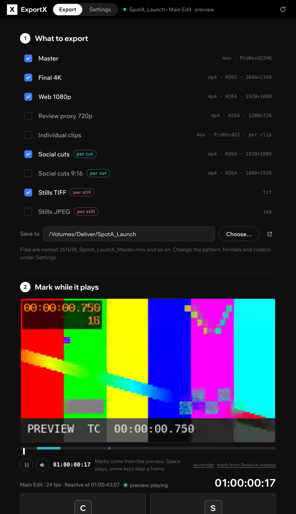

# ExportX

**Batch deliverables for DaVinci Resolve with a few clicks.**

ExportX is a DaVinci Resolve plugin that drives Resolve's own render engine. Watch the cut in the panel, hold **C** to select each social cut, press **S** on each frame you want as a still, then press one button and ExportX queues and renders everything: the final 4K and master exports, one file per cut, one frame per still, each with the right codec, resolution, name (`261018_SpotA_Final.mp4`) and subfolder.

```
┌ X ExportX  [Export] Settings     ● SpotA_Launch › Main Edit     ↻ ┐
│                                                                   │
│ ① What to export                                                  │
│   ☑ Master                               mov · ProRes422HQ        │
│   ☑ Final 4K                             mp4 · H265 · 3840×2160   │
│   ☑ Web 1080p                            mp4 · H264 · 1920×1080   │
│   ☑ Social cuts  (per cut)               mp4 · H264 · 1920×1080   │
│   ☑ Stills TIFF  (per still)             tif                      │
│   Save to  /Volumes/Deliver/SpotA_Launch            [Choose…] ↗  │
│   Files are named 261018_SpotA_Launch_Master.mov and so on.       │
│                                                                   │
│ ② Mark while it plays                                             │
│   ┌───────────────────────────────────────────────────────────┐   │
│   │              ▶  preview of the timeline (720p)            │   │
│   └───────────────────────────────────────────────────────────┘   │
│   ━━━━━▇▇▇━━━━━━━━━━━━│━━━━━━━━━━━━━━━━━━━━━━━━━━━━━━━━━━━━━━━━  │
│   ⏸ 🔈 01:00:04:13     Marks come from the preview.   01:00:04:13 │
│   ┌───────────────────────────┐ ┌───────────────────────────┐   │
│   │   [C]  Hold for a cut     │ │   [S]  Still              │   │
│   └───────────────────────────┘ └───────────────────────────┘   │
│   CUTS 2   01 01:00:04:00 → 01:00:09:11 5.5s   STILLS 1           │
│            02 01:00:42:23 → 01:00:44:03 1.2s   01 01:00:20:20     │
│                                                                   │
│ ③ Export                                                          │
│   [              Export everything · 6 files              ]       │
│   [ Cuts only ]                            [ Stills only ]        │
│   3 final exports · 2 cuts · 1 still → /Volumes/Deliver/…         │
└───────────────────────────────────────────────────────────────────┘
```



**Try it without Resolve:** open [`docs/preview.html`](docs/preview.html) in a browser. It is the real panel bundled with a fake Resolve and a test-pattern video standing in for your timeline, so you can hold C, press S, press Export and edit deliverables in Settings. Rebuild it with `node scripts/build-preview.js`. More screenshots: [holding the pad](docs/screenshots/holding.png), [exporting](docs/screenshots/exporting.png), [Settings](docs/screenshots/settings.png), [phone width](docs/screenshots/narrow.png).

## The loop

1. **What to export.** Tick the final exports you owe (Master, Final 4K, Web 1080p), the per-cut deliverable for social, and the per-still format. Choose the folder once; it is remembered.
2. **Mark while it plays.** Press **Render preview** once and a small 720p copy of the timeline plays in the panel (made by Resolve's render engine, cached per timeline). **Hold C** across a section to select a cut (in on press, out on release); **press S** on a frame to mark a still. Both keys can be changed in Settings, and the two on-screen buttons do the same with the mouse. Space plays and pauses, the arrow keys step a frame, and Resolve's playhead follows when you pause. Each mark becomes a Resolve timeline marker (cyan for cuts, pink for stills), so you see them on the timeline, can trim or delete them there, and they travel with the project. Without a preview, the pad marks from Resolve's own playhead while you play there.
3. **Export.** Press **Export everything**, or **Cuts only** / **Stills only**. ExportX adds one job per deliverable to Resolve's own render queue (cuts as in/out ranges, stills as single-frame image renders), starts the render and shows progress per file.

## Settings

The **Settings** tab edits deliverables in place: name, the label used in file names, whether it applies to the whole timeline, each cut or each still, format and codec (the lists come straight from your Resolve), size, quality or bit rate, a Deliver preset to start from, folder, audio, and whether it is ticked by default. Add, duplicate, reset or delete deliverables there. The same tab holds the file-name pattern with a live example, the capture keys, extra timelines, and the log.

## Is it Resolve's real export engine?

Yes. ExportX encodes nothing itself. It sets the Deliver page's render settings through Resolve's scripting API and adds jobs to Resolve's render queue, so every file comes out of the same renderer as a manual export, with the same formats, codecs and hardware encoders your machine offers. The jobs are visible in the Deliver page while they run. The API does not expose every advanced Deliver option; for those, save a Deliver preset in Resolve and start the deliverable from it in Settings. ExportX then only overrides format, codec, size, name and range.

## What you get

- **Workflow Integration plugin** for Resolve Studio 18+: a panel under *Workspace › Workflow Integrations › ExportX*. One column, three numbered steps, everything else under "More options". Design notes in [docs/DESIGN.md](docs/DESIGN.md).
- **A preview of the timeline in the panel** (a 720p proxy rendered by Resolve, cached per timeline) with a scrub bar that shows your marks, plus **two capture keys**: hold C for a cut, press S for a still, both changeable. Marks map to exact timeline frames and are stored as timeline markers.
- **Settings tab** to change formats, codecs, sizes, quality, presets, folders and labels without touching JSON.
- **Naming convention** `YYMMDD_Project_Label` by default, e.g. `261018_SpotA_Final.mp4`, with a live example and tokens for anything else.
- **Deliverable profiles as JSON** with a `target` of `timeline`, `cuts` or `stills`: nine sensible defaults, add your own in `~/.exportx/profiles/`, override the bundled ones by id. See [docs/PROFILES.md](docs/PROFILES.md).
- **Multi-timeline batches**: pick extra timelines under More options and one click renders the selected deliverables for each.
- **Live progress** per job, pulled from Resolve's queue; stop from the panel.
- **Python edition** (`python/exportx_batch.py`) using the same profiles and markers, for the Scripts menu in the free edition or headless use from a terminal in Studio.
- **No runtime dependencies**, unit-tested against an in-memory Resolve mock, CI on every push.

## Quick start

```bash
git clone https://github.com/triptychvisuals/ExportX.git
cd ExportX
bash scripts/install.sh                 # macOS / Linux (sudo prompt)
# Windows, elevated PowerShell:
# powershell -ExecutionPolicy Bypass -File scripts\install.ps1
```

Restart Resolve Studio and open **Workspace › Workflow Integrations › ExportX**. Full instructions, paths and troubleshooting: [docs/INSTALL.md](docs/INSTALL.md).

Python / CLI:

```bash
python3 python/exportx_batch.py --list                                   # timelines, marks, profiles, formats, codecs
python3 python/exportx_batch.py --all --out ~/Deliver/Job123 --wait      # everything that is marked, named 261018_Project_Label
python3 python/exportx_batch.py --targets stills --out ~/Deliver --render
python3 python/exportx_batch.py --mark-cut 01:00:04:00 01:00:09:12 --mark-still 01:00:12:05
```

## Bundled profiles

| Name | Applies to | Output | Example file | Default |
| --- | --- | --- | --- | --- |
| Master | timeline | QuickTime ProRes 422 HQ, 24-bit PCM | `01_Masters/261018_SpotA_Master.mov` | on |
| Final 4K | timeline | MP4 H.265 3840×2160 | `02_Final/261018_SpotA_Final.mp4` | on |
| Web 1080p | timeline | MP4 H.264 1920×1080 | `02_Final/261018_SpotA_Web.mp4` | on |
| Social cuts | each cut | MP4 H.264 1920×1080 | `04_Social/261018_SpotA_Social_01.mp4` | on |
| Social cuts 9:16 | each cut | MP4 H.264 1080×1920 | `04_Social/9x16/261018_SpotA_Social9x16_01.mp4` | off |
| Stills TIFF | each still | TIFF | `06_Stills/261018_SpotA_Still_01_<frame>.tif` | on |
| Stills JPEG | each still | JPEG | `06_Stills/JPEG/261018_SpotA_Still_01_<frame>.jpg` | off |
| Review proxy 720p | timeline | MP4 H.264 1280×720 | `03_Review/261018_SpotA_Review.mp4` | off |
| Individual clips | timeline | ProRes 422, one file per clip | `05_Clips/` | off |

Change any of these under Settings. Codec lists come from your Resolve, so they match what your machine can encode.

## Repository layout

```
manifest.xml        Resolve plugin manifest (id com.triptychvisuals.exportx)
main.js             Electron main: Resolve connection, playhead polling, marks, preview proxy, settings + render IPC
preload.js          contextBridge API exposed to the UI
ui/                 Panel UI (HTML/CSS/vanilla JS), browser mock + sample video for previews, bundled Wix Madefor fonts (OFL)
src/resolve.js      ResolveBridge: render API, timeline info, playhead, markers
src/batch.js        BatchExporter: profiles × timelines × marks → jobs, render, poll
src/marks.js        Cuts and stills as timeline markers; hold/tap classification
src/timecode.js     Timecode ↔ frames (drop-frame aware)
src/profiles.js     Profile loading and validation
src/naming.js       File-name convention and tokens
profiles/           Bundled deliverable profiles
python/             Python edition (Scripts menu / CLI)
scripts/            install.sh, install.ps1, package.sh, check-syntax.js, build-preview.js, screenshot.js
test/               node:test suites + mock Resolve
docs/               INSTALL, PROFILES, DESIGN, RESOLVE_API, ARCHITECTURE
```

## Development

```bash
node --test                      # unit tests against the mock Resolve
node scripts/check-syntax.js     # parse every JS file
python3 python/exportx_batch.py --selftest

npm install                      # only for mock-mode UI runs (installs Electron)
EXPORTX_MOCK=1 npx electron .    # run the panel outside Resolve against the mock (the mock playhead "plays")
node scripts/build-preview.js    # docs/preview.html: the panel + a fake Resolve in one file, open in any browser
node scripts/screenshot.js       # docs/screenshots/*.png from the same mock (needs playwright + chromium)
bash scripts/install.sh --link   # symlink the repo into Resolve's plugin folder while developing
bash scripts/package.sh          # dist/ExportX-<version>.zip
```

`WorkflowIntegration.node` is Blackmagic's binary and is git-ignored; the install scripts copy it from your Resolve install. See [docs/ARCHITECTURE.md](docs/ARCHITECTURE.md) for how the pieces fit and [docs/RESOLVE_API.md](docs/RESOLVE_API.md) for the slice of the Resolve API in use.

## Requirements

- The plugin panel needs **DaVinci Resolve Studio 18 or newer** (Blackmagic only enables Workflow Integration plugins in Studio).
- The Python edition runs from the Scripts menu in the free edition, and from a terminal in Studio with external scripting enabled.

## License

MIT, see [LICENSE](LICENSE). Bundled fonts are under the SIL Open Font License, see `ui/fonts/LICENSE-OFL.txt`.
